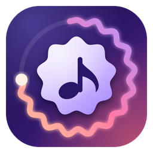

<p align="center">
  
</p>

<h1 align="center">Resonance</h1>

<p align="center">
  An offline music player with a <b>Material 3 Expressive</b> look, a real 10-band equalizer,
  word-by-word synced lyrics and built-in YouTube search &amp; download.
</p>

---

## Features

**Player**
- Plays local `mp3`, `flac`, `ogg`, `opus`, `m4a`, `aac`, `wav`, `webm`. Add folders from the sidebar or drop them onto the window.
- Library views: tracks, albums, artists, favourites. Fast search across title, artist and album.
- Queue, shuffle, repeat (off / all / one), playback speed (0.75–1.5×) and a sleep timer with a fade-out.
- Media keys and the OS media overlay are supported.

**Design**
- Material 3 Expressive: tonal surfaces, large shapes, shape-morphing buttons and spring motion.
- The whole palette is generated from the cover art of the current track (OKLCH tonal palette) and changes smoothly between tracks. Dark and light themes.
- A wavy progress ring around the cover that fills as the track plays (drag it to seek), plus a wavy progress bar.
- An optional visualizer behind the transport controls (toggle button next to the sleep timer).
- The window header is hidden until you move the pointer to the top edge, then slides in over the UI without moving anything.

**Sound**
- 10-band equalizer (31 Hz – 16 kHz, ±12 dB) with a live frequency-response curve and 8 presets.
- Preamp, stereo balance, mono, left/right swap, dynamics (off / balanced / night) and a speaker test tone.
- Built on the Web Audio API, so it works on every track, local or downloaded.

**Lyrics**
- Synced lyrics from [LRCLIB](https://lrclib.net), cached on disk. The active line is in focus, the rest fades with distance, and words inside the line fill progressively. Click a line to seek.
- LRCLIB provides timestamps per *line*, not per word, so word timing inside a line is estimated from word length. Plain (unsynced) lyrics are shown when no synced version exists.

**YouTube (optional)**
- Search YouTube from the same search box; click a result to download its audio and play it immediately.
- Can be switched off in *Settings*. When off, search is local only; when on, results from YouTube and the local library are shown together.
- Downloads go to `Music\Resonance` and become part of your library (with cover art and title/artist taken from the video).
- Uses [yt-dlp](https://github.com/yt-dlp/yt-dlp), which Resonance downloads on first use (it is not bundled). *Settings → yt-dlp → Update* refreshes it when YouTube changes something.

## Install

Download `Resonance Setup <version>.exe` from the releases page (or build it yourself, see below) and run it.

The installer is **not code-signed**, so Windows SmartScreen may show an "unknown publisher" warning. Choose *More info → Run anyway*.

Resonance currently targets **Windows 10/11 (x64)**. The yt-dlp integration downloads the Windows executable.

## Keyboard

| Key | Action |
| --- | --- |
| `Space` | Play / pause |
| `Ctrl` + `→` / `←` | Next / previous track |
| `/` | Focus search |

## Build from source

Requires [Node.js](https://nodejs.org) 20 or newer.

```bash
git clone <this repository>
cd resonance
npm install

npm start          # run in development
npm run icons      # regenerate build/icon.svg, icon.png, icon.ico
npm run dist       # build the NSIS installer into dist/
```

Project layout:

```
src/main.js      Electron main process: library scan, rmedia:// protocol (HTTP Range support), YouTube, lyrics, window
src/preload.js   Safe bridge between main and renderer
src/util.js      Helpers and icon set
src/eq.js        Web Audio graph (equalizer, balance, dynamics) and the "Sound" view
src/viz.js       Visualizer
src/lyrics.js    LRC parsing and the word-by-word lyrics view
src/app.js       Library, search, playback, settings, UI wiring
src/styles.css   Material 3 Expressive styling
tools/           Icon generator
```

## Data and privacy

- Settings, favourites and the equalizer state are stored in the app profile (`%APPDATA%\Resonance`).
- Lyrics requests go to `lrclib.net`; YouTube search and downloads go to YouTube. Nothing else leaves your machine, and there is no telemetry.

## Legal note

Downloading content from YouTube may violate YouTube's Terms of Service and the copyright of the content owners, depending on what you download and where you live. Resonance only provides the tooling; **use it for content you have the right to download** (your own uploads, Creative Commons or public-domain music, and so on). The YouTube features can be turned off in *Settings*.

## Acknowledgements

- [yt-dlp](https://github.com/yt-dlp/yt-dlp) (Unlicense), [yt-search](https://github.com/talmobi/yt-search) (MIT), [music-metadata](https://github.com/Borewit/music-metadata) (MIT), [Electron](https://www.electronjs.org) (MIT), [electron-builder](https://www.electron.build) (MIT).
- Lyrics: [LRCLIB](https://lrclib.net).
- The equalizer's band layout and presets were inspired by the media widget of [ilyamiro/serpantinum](https://github.com/ilyamiro/serpantinum).
- Design language: [Material 3 Expressive](https://m3.material.io).

## License

Copyright (C) 2026 RedArtem39

This program is free software: you can redistribute it and/or modify it under the terms of the **GNU General Public License** as published by the Free Software Foundation, either **version 3** of the License, or (at your option) any later version.

This program is distributed in the hope that it will be useful, but WITHOUT ANY WARRANTY; without even the implied warranty of MERCHANTABILITY or FITNESS FOR A PARTICULAR PURPOSE. See the [GNU General Public License](LICENSE) for more details.
